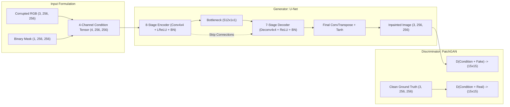
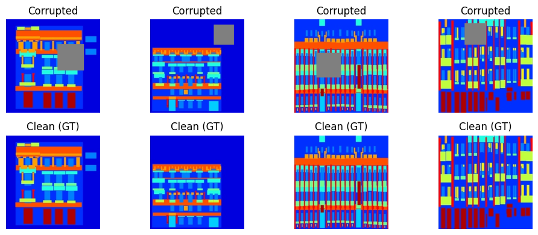
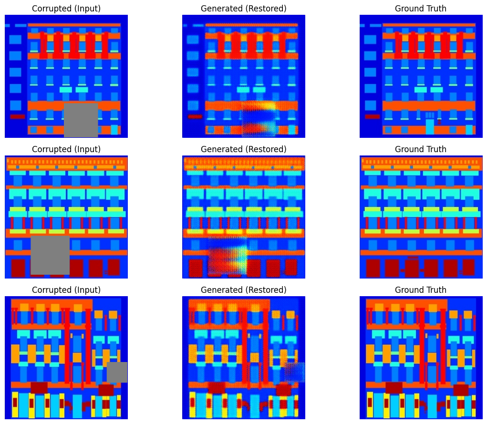
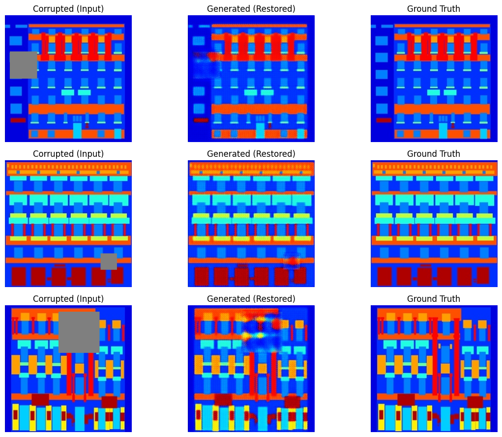
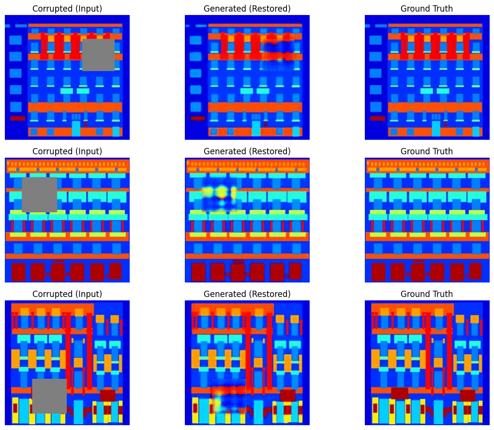
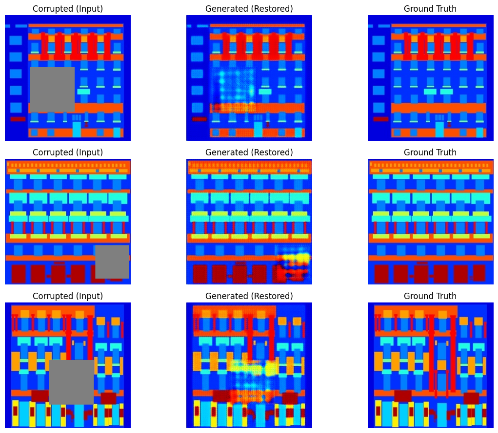

# Deep Image Inpainting & Semantic Scene Reconstruction using Conditional GANs (Pix2Pix)

[](https://www.python.org/)
[](https://pytorch.org/)
[](https://pytorch.org/vision/)
[](https://gradio.app/)
[](https://opensource.org/licenses/MIT)

An end-to-end deep learning and computational computer vision pipeline for **dense image restoration and inpainting** on complex architectural scenes ([CMP Facades dataset](http://efrosgans.eecs.berkeley.edu/pix2pix/datasets/facades.tar.gz)). This project implements an optimized **Conditional Generative Adversarial Network (cGAN / Pix2Pix)** combining an 8-stage symmetric **U-Net Generator** with skip connections and a **70×70 PatchGAN Discriminator**, constrained by a multi-task objective of adversarial loss and heavy $\mathcal{L}_1$ pixel reconstruction penalty ($\lambda = 100$).

---

## 📑 Table of Contents
1. [Theoretical Background: Classical vs. Deep Inpainting](#theoretical-background-classical-vs-deep-inpainting)
2. [Mathematical Formulation & Architecture](#mathematical-formulation--architecture)
   - [Generator: 8-Stage U-Net Encoder-Decoder](#generator-8-stage-u-net-encoder-decoder)
   - [Discriminator: 70×70 PatchGAN](#discriminator-7070-patchgan)
   - [Multi-Task Objective Function](#multi-task-objective-function)
3. [Algorithmic Pipeline & Dataset Formulation](#algorithmic-pipeline--dataset-formulation)
4. [Training Dynamics & Quantitative Evaluation](#training-dynamics--quantitative-evaluation)
5. [Visual Results & Comparative Analysis](#visual-results--comparative-analysis)
6. [Interactive Inference Demo (Gradio)](#interactive-inference-demo-gradio)
7. [Installation & Reproducibility Guide](#installation--reproducibility-guide)
8. [Authors & Academic Context](#authors--academic-context)

---

## Theoretical Background: Classical vs. Deep Inpainting

Image inpainting is the ill-posed inverse problem of estimating missing or occluded image regions $\Omega \subset \mathbb{R}^2$ from observed boundary data $\partial\Omega$ and surrounding uncorrupted context $\mathbb{R}^2 \setminus \Omega$:

$$\hat{I}(x, y) = \arg\min_I \mathcal{E}(I) \quad \text{s.t.} \quad I|_{\mathbb{R}^2 \setminus \Omega} = I_{\text{obs}}$$

### Classical Partial Differential Equation (PDE) Methods
Traditional computer vision approaches rely on local spatial continuity:
1. **Navier-Stokes Fluid Dynamics (Bertalmio et al., 2001)**: Propagates isophote lines (lines of equal intensity) continuously into $\Omega$ by treating the image intensity gradient as a 2D incompressible fluid stream function $\nabla \cdot (\nabla^\perp I \cdot \Delta I) = 0$.
2. **Fast Marching Method (Telea, 2004)**: Propagates pixel values along an inward-moving boundary level set using a weighted sum of neighbor gradients over small radii $r$:
   $$I(p) = \frac{\sum_{q \in B_\epsilon(p)} w(p, q) \cdot [I(q) + \nabla I(q) \cdot (p - q)]}{\sum_{q \in B_\epsilon(p)} w(p, q)}$$

**Limitations of Classical Methods**: While effective for thin scratches and small scratches ($< 10$ pixels), classical PDE and exemplar/patch-based methods (e.g., PatchMatch) fail catastrophically when reconstructing **large semantic holes ($32 \times 32$ to $96 \times 96$ pixels)** containing structured geometry (e.g., windows, balconies, arches), resulting in severe blurring, lack of structural hallucination, and boundary artifacts.

### The Conditional GAN Paradigm
To resolve high-level structural semantics and fine-grained textures, this project employs a **Conditional Generative Adversarial Network (cGAN)**. The generator $G$ acts as a structural prior conditioned on both the corrupted RGB features and the spatial indicator mask, learning the conditional distribution $p(I_{\text{target}} \mid I_{\text{corrupt}}, M)$.

---

## Mathematical Formulation & Architecture



### Generator: 8-Stage U-Net Encoder-Decoder
- **Encoder**: 8 downsampling convolutional blocks ($4 \times 4$ kernel, stride 2, padding 1). Resolves spatial dimensions from $256 \times 256 \to 1 \times 1$:
  $$\text{Feature Maps: } 64 \to 128 \to 256 \to 512 \to 512 \to 512 \to 512 \to 512$$
- **Decoder**: 7 transposed convolutional upsampling blocks ($4 \times 4$ kernel, stride 2, padding 1).
- **Skip Connections**: Concatenates encoder feature maps $e_i$ directly with corresponding decoder features $d_{8-i}$. This preserves high-frequency edge localization and structural coordinates, bypassing the bottleneck:
  $$x_{\text{dec}} = [d_{k}, e_{8-k}]$$
- **Output Layer**: $4 \times 4$ ConvTranspose mapping 128 channels to 3 RGB channels with a $\tanh(\cdot)$ non-linearity constraining outputs to $[-1, 1]$.

### Discriminator: 70×70 PatchGAN
Rather than outputting a single scalar validity score for the whole image, the discriminator $D$ evaluates local $70 \times 70$ overlapping patches:
- **Conditioning**: Concatenates condition tensor (4 channels) and candidate image (3 channels) into a **7-channel input** $Z \in \mathbb{R}^{7 \times 256 \times 256}$.
- **Receptive Field**: 4 downsampling blocks produce an output tensor of shape $(B, 1, 15, 15)$, where each unit acts as a classifier determining whether a specific spatial patch corresponds to a real natural scene or an algorithmic artifact.

### Multi-Task Objective Function
The network is optimized through a coupled minimax game with a structured L1 regularization:

$$\min_G \max_D \mathcal{L}_{\text{total}}(G, D) = \mathcal{L}_{\text{cGAN}}(G, D) + \lambda \mathcal{L}_{L1}(G)$$

Where:
$$\mathcal{L}_{\text{cGAN}}(G, D) = \mathbb{E}_{x, y} \left[\log D(x, y)\right] + \mathbb{E}_{x} \left[\log (1 - D(x, G(x)))\right]$$
$$\mathcal{L}_{L1}(G) = \mathbb{E}_{x, y} \left[ \| y - G(x) \|_1 \right]$$

Setting $\lambda = 100$ penalizes structural deviations from the ground truth while the adversarial loss $\mathcal{L}_{\text{cGAN}}$ prevents the characteristic blurriness of pure $L_1 / L_2$ regressions by forcing high-frequency realism.

---

## Algorithmic Pipeline & Dataset Formulation

1. **Dataset Split & Normalization**:
   - The CMP Facades dataset pairs semantic labels (left) and architectural photographs (right). Each image is parsed, selecting the photo component $B \in \mathbb{R}^{3 \times 256 \times 256}$ and normalizing pixel intensities to $[-1, 1]$:
     $$I_{\text{norm}} = \frac{I - 127.5}{127.5}$$
2. **Stochastic Mask Synthesis**:
   - Dynamic bounding-box corruption generator creates rectangular masks $M(y, x) \in \{0, 1\}$ with hole size sampled uniformly:
     $$s \sim \mathcal{U}(32, 96), \quad x_0 \sim \mathcal{U}(0, W - s), \quad y_0 \sim \mathcal{U}(0, H - s)$$
     $$M(y, x) = 0 \quad \forall (y, x) \in [y_0, y_0+s) \times [x_0, x_0+s)$$
3. **Corrupted Tensor Construction**:
   - $I_{\text{corrupt}} = I_{\text{clean}} \odot M$
   - Concatenation: Input tensor $X = [I_{\text{corrupt}}, M] \in \mathbb{R}^{4 \times 256 \times 256}$.


*Figure 1: Stochastic mask generation on training samples. Top: Synthetically occluded input; Bottom: Clean ground truth facade.*

---

## Training Dynamics & Quantitative Evaluation

The model was trained for **20 epochs** using the Adam optimizer ($\beta_1 = 0.5, \beta_2 = 0.999$, learning rate $\alpha = 2 \times 10^{-4}$) with batch size 16 on GPU hardware.

Evaluation was performed on unseen test images using standard image reconstruction metrics:
- **Peak Signal-to-Noise Ratio (PSNR)**:
  $$\text{PSNR} = 10 \cdot \log_{10}\left(\frac{\text{MAX}_I^2}{\text{MSE}}\right)$$
- **Structural Similarity Index Measure (SSIM)**:
  $$\text{SSIM}(x, y) = \frac{(2\mu_x\mu_y + c_1)(2\sigma_{xy} + c_2)}{(\mu_x^2 + \mu_y^2 + c_1)(\sigma_x^2 + \sigma_y^2 + c_2)}$$

### Quantitative Convergence Table
| Epoch | Discriminator Loss ($D$) | Generator Loss ($G$) | Test PSNR (dB) | Test SSIM | Qualitative Checkpoint |
| :---: | :---: | :---: | :---: | :---: | :--- |
| **01** | 0.5523 | 31.2630 | 16.32 dB | 0.3127 | Initial coarse color fill |
| **05** | 0.5861 | 9.2903 | 21.17 dB | 0.7354 | Emergence of window frames |
| **10** | 0.5688 | 8.3263 | 21.64 dB | 0.7687 | Coherent structural edges |
| **15** | 0.5723 | 7.6376 | 22.42 dB | 0.7934 | High-frequency brick texture alignment |
| **20** | 0.5638 | 7.5449 | **22.58 dB** | **0.8055** | Converged seamless inpainting |

---

## Visual Results & Comparative Analysis

Visual progression across training demonstrates the rapid transition from low-frequency mean color synthesis to sharp structural completion:

### Epoch 5 vs Epoch 10 Progression
| Epoch 5 Results | Epoch 10 Results |
| :---: | :---: |
|  |  |
| *Epoch 5: Rough spatial infill with minor border artifacts* | *Epoch 10: Clear delineation of architectural edges* |

### Epoch 15 vs Final Converged Epoch 20
| Epoch 15 Results | Epoch 20 Final Results |
| :---: | :---: |
|  |  |
| *Epoch 15: Consistent global illumination and framing* | *Epoch 20: High-fidelity reconstruction (PSNR: 22.58 dB, SSIM: 0.81)* |

---

## Interactive Inference Demo (Gradio)

The notebook includes a real-time **Gradio Web Interface** for dynamic model evaluation:
- **Interactive Mask Size Slider**: Adjust hole size dynamically between $16 \text{ px}$ and $128 \text{ px}$.
- **Center-Mask Stress Testing**: Validates model generalization on varying occluding apertures.
- **Instant Quantitative Telemetry**: Computes and displays live PSNR and SSIM readouts for every generated sample.

To launch the demo locally:
```python
import gradio as gr
demo.launch(share=True)
```

---

## Installation & Reproducibility Guide

### 1. Clone the Repository
```bash
git clone https://github.com/Nimasoy/image-inpainting-cgan.git
cd image-inpainting-cgan
```

### 2. Set Up Virtual Environment & Dependencies
```bash
python -m venv venv
source venv/bin/activate   # On Windows: venv\Scripts\activate
pip install torch torchvision numpy scikit-image matplotlib Pillow gradio
```

### 3. Run the Jupyter Notebook
```bash
jupyter notebook FacadesModel.ipynb
```

The notebook automatically handles dataset retrieval, training iterations, validation telemetry, and launches the Gradio demo interface.

---

## Project Structure
```plaintext
image-inpainting-cgan/
├── assets/                          # Extracted visual checkpoints & comparisons
│   ├── dataset_samples.png
│   ├── results_epoch_05.png
│   ├── results_epoch_10.png
│   ├── results_epoch_15.png
│   └── results_epoch_20_final.png
├── FacadesModel.ipynb               # Complete end-to-end training & evaluation pipeline
├── .gitignore                       # Git exclusion rules for large datasets/weights
└── README.md                        # Theoretical documentation & project report
```

---

## Authors & Academic Context

- **Nima Rezaei** (Student ID: `401130373`)
- **Arman Esmaeili** (Student ID: `401130133`)

Developed as the **Computer Vision Final Project**, exploring deep generative architectures for visual reconstruction, spatial continuity modeling, and image restoration.
